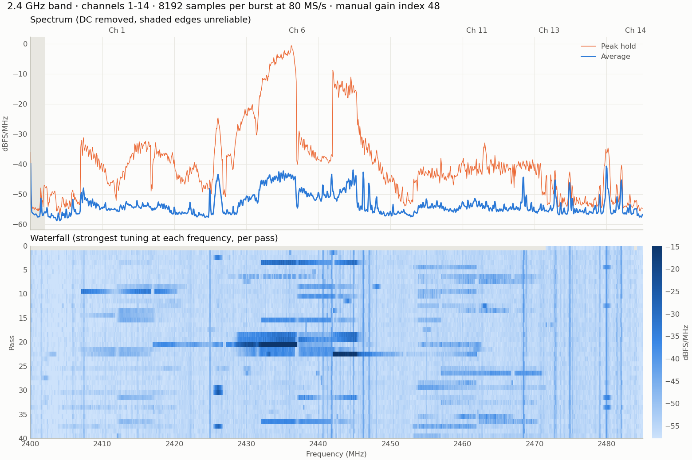
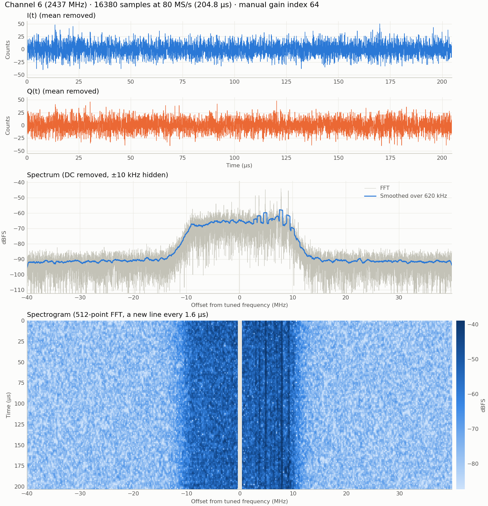

# esp32-sdr-firmware

**A 2.4 GHz software-defined radio receiver built on a standard ESP32, with no RF hardware added.**

This project turns a NodeMCU-style ESP32 (Xtensa LX6) into a raw I/Q receiver. It uses the modem's undocumented sample-dump path to write baseband samples straight into SRAM, without starting the 802.11 MAC or the Wi-Fi driver. A 25 MHz SPI link carries the samples to a Raspberry Pi 5, past the limit of the board's CP2102 USB-UART bridge, and a Python toolchain on the Pi and a PC does the signal processing.

- **Raw I/Q capture** at 80, 40 or 16 MS/s, in bursts of up to 16,380 samples of 10-bit I and Q
- **2.34 MB/s** of verified samples over SPI, about 30× what the UART delivered (77 KiB/s)
- **Full-band panorama** of 2.4 GHz, stitched from channel hops at up to 6.8 passes per second
- **BLE advertising demodulator** in pure NumPy/SciPy, from I/Q samples to parsed PDUs with CRC-24 verification
- **Bridge to standard SDR tools** through raw I/Q streams and an `rtl_tcp` server

> **This is a burst receiver, not a continuous one.** The radio captures a snapshot of at most about 1 ms, and then has to send it. It's excellent for spectrum surveys, signal inspection and teaching, but it misses whatever happens between bursts. See [Known limitations](#known-limitations).



*A real panorama from `band_sweep.py`: average, peak hold and a per-pass waterfall, with Wi-Fi networks visible on channels 1, 6 and 11.*

## Contents

- [System architecture](#system-architecture)
- [Hardware](#hardware)
- [Key techniques](#key-techniques)
- [Installation](#installation)
- [Usage](#usage)
- [BLE physical layer](#ble-physical-layer)
- [Measured performance](#measured-performance)
- [Protocol reference](#protocol-reference)
- [Known limitations](#known-limitations)
- [Troubleshooting](#troubleshooting)
- [Repository layout](#repository-layout)
- [Acknowledgments](#acknowledgments)
- [Responsible use](#responsible-use)
- [License](#license)

## System architecture

```text
 ESP32 (NodeMCU)
+---------------------------------------------------------------------------+
|                                                                           |
|  Antenna --> RF front-end --> Analog filter --> I/Q ADC                   |
|              PLL tuned        about +/- 11 MHz    |                       |
|              2400-2500 MHz                        |                       |
|                                                   v                       |
|                                    Modem dump engine (80/40/16 MS/s)      |
|                                    802.11 MAC and Wi-Fi driver not running|
|                                                   |  hardware write       |
|                                                   v                       |
|                                    64 KiB reserved SRAM bank              |
|                                                   |  CPU copy, per-frame  |
|                                                   |  CRC-32 (core 0)      |
|                                        +----------+----------+            |
|                                        v                     v            |
|                                 Burst buffer A         Burst buffer B     |
|                                 (being filled)         (being sent)       |
|                                        +----------+----------+            |
|                                                   |  DMA (core 1)         |
|                                                   v                       |
|                                    SPI slave, 4,096-byte frames  ---+     |
|                                                   ^                 |     |
|                                 UART0 (health)    |   Handshake     |     |
+---------------------------------|-----------------|-----------------|-----+
                                  |                 |                 |
                             CP2102 USB       Commands (MOSI)    25 MHz SPI (MISO)
                                  |                 |            GPIO 22 ready line
                                  v                 |                 v
                          (ping/heartbeat)  +-------+-----------------------------+
                                            |  Raspberry Pi 5: pi_receiver.py     |
                                            |  - paces transfers on the handshake |
                                            |  - verifies CRC and sequence number |
                                            |  - saves .npy / .bin files          |
                                            |  - serves bursts over TCP           |
                                            +------------------+------------------+
                                                               |
                                                       Ethernet / LAN (TCP)
                                                               |
                                                               v
                                            +-------------------------------------+
                                            |  PC                                 |
                                            |  plot_capture.py  time/FFT/waterfall|
                                            |  band_sweep.py    band panorama     |
                                            |  ble_demod.py     BLE demodulator   |
                                            |  sdr_source.py    SDR tools bridge  |
                                            +-------------------------------------+
```

### Why two buffers

The dump engine owns its SRAM bank while it captures, and it only takes snapshots. So the CPU copies each snapshot into one of two burst buffers, which alternate roles: while SPI drains one, the radio can capture into the other. The second burst of a stream arrives about 6 ms after the first, while the first is still being sent. After that, bursts are paced by the SPI link, about 28 ms apart for a full-size burst.

## Hardware

### Bill of materials

| Item | Notes |
|---|---|
| ESP32 board | Developed on a NodeMCU-style board with an ESP32-D0WD-V3, 4 MB flash and a CP2102 |
| Raspberry Pi 5 | Developed on the 4 GB model running Debian 13 (trixie) |
| 6 jumper wires | Keep them short. The MISO timing depends on them |
| PC | Linux, for the processing tools. Linked to the Pi over Ethernet |

### Wiring

Both boards use 3.3 V logic, so no level shifting is needed.

| Signal | Direction | ESP32 GPIO | Raspberry Pi 5 physical pin | Pi BCM GPIO |
|---|---|---|---|---|
| SCLK | Pi → ESP32 | GPIO 18 | Pin 23 | BCM 11 |
| MISO | ESP32 → Pi | GPIO 19 | Pin 21 | BCM 9 |
| MOSI | Pi → ESP32 | GPIO 23 | Pin 19 | BCM 10 |
| CS | Pi → ESP32 | GPIO 5 | Pin 24 (CE0) | BCM 8 |
| Handshake | ESP32 → Pi | GPIO 22 | Pin 22 | BCM 25 |
| GND | Common | GND | Pin 25 (or any GND) | - |

```text
   NodeMCU ESP32                         Raspberry Pi 5
  +-------------+                      +----------------+
  |     GPIO 18 |<------- SCLK --------| Pin 23 (BCM 11)|
  |     GPIO 19 |-------- MISO ------->| Pin 21 (BCM 9) |
  |     GPIO 23 |<------- MOSI --------| Pin 19 (BCM 10)|
  |      GPIO 5 |<------- CS ----------| Pin 24 (BCM 8) |
  |     GPIO 22 |-------- READY ------>| Pin 22 (BCM 25)|
  |         GND |--------------------- | Pin 25 (GND)   |
  +-------------+                      +----------------+
```

GPIO 18, 19, 23 and 5 are the ESP32's native VSPI pins. They bypass the slower GPIO matrix, which the higher clock rates need.

## Key techniques

### Minimal radio bring-up

The firmware never calls `esp_wifi_init()` or `esp_wifi_start()`, and neither is in the final binary, so there are no Wi-Fi tasks and no MAC. The radio needs just enough to calibrate and tune:

```c
esp_wifi_bt_power_domain_on();   // The modem registers read as zero without this
wifi_bt_common_module_enable();
wifi_module_enable();
esp_phy_enable(PHY_MODEM_WIFI);  // Runs the PHY calibration
```

Enabling the clocks isn't enough on its own. The Wi-Fi power domain has to be on first, or the whole modem register block silently reads back as zero.

### 25 MHz SPI, past the documented limit

ESP-IDF documents 10 MHz as the ESP32's SPI slave limit, with MISO limited to under 11.4 MHz even on the native pins. Three things make 25 MHz work on this hardware:

1. **SPI mode 0.** With DMA, modes 0 and 2 launch MISO half a clock early. ESP-IDF recommends modes 1 and 3, but with the Pi 5 as master those failed from 10 MHz up.
2. **MISO delay compensation.** At 20-25 MHz, MISO arrives exactly one clock late, as a consistent shift and not as random errors. `pi_receiver.py` measures the delay at startup against a known idle frame, reads a few extra bytes, and shifts the received bits back into place.
3. **Handshake and resend.** The ESP32 raises GPIO 22 only when a frame is armed. Activity on CS just after a transfer can end the next frame early, so the ESP32 checks that each frame was fully clocked and resends it if it wasn't.

Every frame carries a CRC-32 and a sequence number, so any failure of this link is detected, not silently passed on. This is measured behavior on one setup and not a guarantee: see [SPI clock](#spi-clock).

### DC offset: hardware calibration plus software removal

On every retune the firmware remeasures the receiver's DC offset by rebuilding the PHY's DC and gain tables, while keeping the startup IQ calibration. This takes about 9 ms. What remains is removed in software, as the mean of each burst, in `--remove-dc` and in the plotting tools. In the spectrogram each line removes its own mean, so a DC step from an AGC gain change can't smear across the band.

| Gain index | DC / noise ratio, before calibration | After calibration |
|---|---|---|
| 72 | 0.34 - 1.03 | 0.06 - 0.42 |
| 64 | 0.65 - 1.42 | 0.07 - 0.38 |

### The 16 MS/s window for BLE

A BLE advertising packet on the 1M PHY lasts 128-376 µs, plus time for the packet to land inside the window at all.

| Sample rate | Longest burst (16,380 samples) | Fits any legacy advertising packet? |
|---|---|---|
| 80 MS/s | 205 µs | No: longer packets are cut off |
| 40 MS/s | 410 µs | Only just |
| 16 MS/s | 1,024 µs | Yes |

16 MS/s spans only ±8 MHz, and channel 37 at 2402 MHz is 10 MHz from the nearest Wi-Fi channel. So the firmware can also tune to any whole MHz from 2400 to 2500, using a ROM function to retune from a Wi-Fi channel. `--ble` tunes 2 MHz above the BLE channel, which keeps the packet away from the receiver's own DC offset.

### Clean captures after boot

The first capture after boot starts with about 7 µs of excess power, regardless of how long the firmware waits first. `rf_capture_tune()` discards a short capture to clear it. Hops between channels were measured clean, with or without this.

## Installation

### 1. Firmware

Requires [ESP-IDF](https://docs.espressif.com/projects/esp-idf/en/v5.5.4/esp32/get-started/index.html). **Developed and tested on v5.5.4.** The firmware calls private PHY functions and undocumented registers, so other 5.x releases may need checking.

```bash
git clone -b v5.5.4 --recursive https://github.com/espressif/esp-idf.git ~/esp/esp-idf
```

```bash
~/esp/esp-idf/install.sh esp32
```

Then, in the root of this repository:

```bash
. ~/esp/esp-idf/export.sh
```

```bash
idf.py build
```

```bash
idf.py -p /dev/ttyUSB0 -b 460800 flash
```

Build settings live in `sdkconfig.defaults`. The `sdkconfig` file is generated from it, so delete `sdkconfig` after editing the defaults.

### 2. Raspberry Pi 5

Enable SPI, install the dependencies, and allow larger SPI transfers:

```bash
sudo raspi-config nonint do_spi 0
```

```bash
sudo apt install python3-spidev python3-libgpiod python3-numpy
```

```bash
echo 'options spidev bufsiz=65536' | sudo tee /etc/modprobe.d/spidev.conf
```

```bash
sudo usermod -aG spi,gpio "$USER"
```

Then reboot. `pi_receiver.py` needs:

- **The libgpiod 2.x Python API.** Debian 13 ships it. Debian 12 ships the older 1.x API, which won't work.
- **A spidev buffer of at least 4,100 bytes.** The kernel's default of 4,096 is too small, and `pi_receiver.py` stops with a message if so.

Copy the tools over from your PC:

```bash
scp tools/pi_receiver.py tools/band_sweep.py tools/plot_capture.py pi@192.168.77.2:~/
```

The examples below assume the Pi is at `192.168.77.2` on a direct Ethernet link. Replace that with your Pi's address.

### 3. PC

Python 3.10 or later on Linux:

```bash
python3 -m venv .venv
```

```bash
. .venv/bin/activate
```

```bash
pip install numpy scipy matplotlib pyserial
```

Use a separate terminal from the one running ESP-IDF's `export.sh`, which activates its own Python environment.

### 4. Check the installation

The BLE self-test needs no hardware at all:

```bash
python3 tools/ble_demod.py --self-test
```

To check the firmware is running, ping it over USB. This opens the serial port, which **resets the ESP32**:

```bash
python3 tools/test_link.py --count 100
```

To check the SPI link, run this on the Pi:

```bash
python3 pi_receiver.py --channel 6 --gain 64 --bursts 100
```

It should finish with `PASS` and report a MISO delay of 1 clock at 25 MHz.

## Usage

Capture runs on the Pi, and processing runs on the PC. Run `--help` on any tool for its full options.

### Choosing a gain

Gain is an index into the PHY's table, not a value in dB. The highest index is 81. Near the top of the range, noise rises by about 0.9 dB per index.

| Situation | Suggested gain |
|---|---|
| Band sweeps, or a transmitter nearby | 48, or 32 if it's very close |
| Weak signals, nothing transmitting nearby | 64 |
| Single captures where levels don't matter | `agc` |

A strong nearby transmitter can overload the receiver **without any ADC clipping**. In one test, traffic on Wi-Fi channel 6 from a laptop close to the board raised the whole band by 11-14 dB at gain 64, while at gain 32 it added 24 dB on channel 6 and at most 0.5 dB elsewhere.

### Single-channel capture and inspection

On the Pi, capture 10 full bursts from Wi-Fi channel 6:

```bash
python3 pi_receiver.py --channel 6 --gain 64 --bursts 10 --out capture.npy
```

Copy both the samples and their metadata to the PC:

```bash
scp pi@192.168.77.2:~/capture.npy pi@192.168.77.2:~/capture.json .
```

Plot one burst as I(t), Q(t), an FFT and a spectrogram. Omit `--save` to open a window:

```bash
python3 tools/plot_capture.py capture.npy --burst 0 --save capture.png
```



`.npy` files hold `complex64` samples in ADC counts, with full scale at 512, one burst after another. The `.json` file next to them records where each burst starts, and its tuning, rate and gain. Any other file extension saves the raw 32-bit words. `--remove-dc` subtracts each burst's mean before saving.

Other ways to tune and capture:

```bash
python3 pi_receiver.py --freq 2450 --rate 40 --samples 8192 --gain 48 --bursts 10 --out capture.npy
```

To stream over TCP as well, and pull from the PC:

```bash
python3 pi_receiver.py --channel 6 --gain 64 --bursts 0 --tcp-port 5555 --tcp-bind 192.168.77.2
```

```bash
python3 tools/pi_receiver.py --connect 192.168.77.2:5555 --count 100 --out capture.npy
```

`--bursts 0` runs until Ctrl+C. The TCP stream has **no authentication**, so bind it to a trusted interface as shown. It's read-only: clients can't send commands to the radio. A slow client loses bursts instead of stalling capture, and the gaps are reported.

### Full-band panorama

Start a sweep on the Pi. Channel 14 extends full-sensitivity coverage to the top of the band:

```bash
python3 pi_receiver.py --sweep 1-14 --gain 48 --samples 8192 --bursts 0 --tcp-port 5555 --tcp-bind 192.168.77.2
```

Build the panorama on the PC:

```bash
python3 tools/band_sweep.py --connect 192.168.77.2:5555 --passes 40 --save panorama.png --npz panorama.npz
```

Or watch it build live:

```bash
python3 tools/band_sweep.py --connect 192.168.77.2:5555 --live
```

Or stitch a saved sweep, which also runs on the Pi for a text summary and data file:

```bash
python3 tools/band_sweep.py sweep.npy --save panorama.png
```

Sweeps need a manual gain, because AGC would scale each channel differently. Each frequency is seen from several tunings, which is what the stitching relies on:

- **Average trace:** a median across tunings of each tuning's time-averaged PSD, which rejects anything fixed to the tuning, such as DC or a spur. It also tends to hide short bursts.
- **Peak hold:** the strongest value seen. Use this for short bursts.
- **Filter correction:** the receiver's passband shape is estimated from the sweep itself and removed.

Levels are in dBFS/MHz, relative to the ADC's full scale, and not absolute power.

### BLE advertising sniffer

Start on one advertising channel (37, 38 or 39) on the Pi. `--ble` sets the tuning and the 16 MS/s rate:

```bash
python3 pi_receiver.py --ble 37 --gain 48 --bursts 0 --tcp-port 5555 --tcp-bind 192.168.77.2
```

Decode live on the PC:

```bash
python3 tools/ble_demod.py --connect 192.168.77.2:5555
```

Or decode a saved capture, with `--verbose` to also show packets that failed the CRC:

```bash
python3 tools/ble_demod.py capture.npy --verbose
```

Example output, from the self-test's synthetic packet:

```text
[burst 0 +196 us] BLE ch 37 ADV_IND, 19 bytes, CRC OK 0x0EDE58
  signal: -8.2 dBFS, carrier offset +41.9 kHz, deviation 242 kHz, Access Address errors 0, timing correction -0.75 samples
  AdvA: 11:22:33:44:55:66 (random, non-resolvable private)
  AdvData: 02010605095465737403030f18
    Flags: LE General Discoverable, BR/EDR Not Supported
    Complete name: 'Test'
    Complete 16-bit UUIDs: 0x180F
bursts: 1, packets with valid CRC: 1, CRC failures: 0, cut off by the burst's end: 0
     1 x 11:22:33:44:55:66 (random, non-resolvable private)
```

The demodulator needs SciPy, so it normally runs on the PC. It takes about 5 ms per burst there, against about 28 ms between bursts.

### SDR tools bridge

`sdr_source.py` connects to a Pi streaming on one frequency. It isn't for sweeps.

Stream to another program as interleaved `cf32`, `cs16` or `cu8`:

```bash
python3 tools/sdr_source.py --connect 192.168.77.2:5555 --out - --format cf32 --rate 2048000 > samples.cf32
```

Save a file for inspectrum:

```bash
python3 tools/sdr_source.py --connect 192.168.77.2:5555 --out capture.cf32 --count 200
```

Write to a named pipe:

```bash
python3 tools/sdr_source.py --connect 192.168.77.2:5555 --out /tmp/iq.fifo --mkfifo --rate 2048000
```

Serve `rtl_tcp`, with a digital gain because 8-bit output has so little range at low gain settings:

```bash
python3 tools/sdr_source.py --connect 192.168.77.2:5555 --rtl-tcp 1234 --digital-gain-db 24
```

Then point a client at it, such as Gqrx with the device string `rtl_tcp=127.0.0.1:1234`.

The tools expect a continuous stream, so `--gaps` chooses how to present the time between bursts:

| Mode | Behavior | Good for | Not good for |
|---|---|---|---|
| `join` (default) | Bursts directly after one another, at about 4% of the nominal rate | Spectrum displays | Timing, demodulating across bursts |
| `zeros` | Silence in the gaps, from the capture timestamps, at the nominal rate | Anything needing true time | Power levels, which read far too low |

The Pi's tuning and gain are fixed when it starts streaming. An `rtl_tcp` client can retune only within the captured band, which is done digitally, and can change the sample rate up to the captured rate. Gain commands are ignored.

> **Compatibility status:** the bridge's formats and the `rtl_tcp` protocol have been tested numerically against a purpose-built client, and against real captures decoded back through the file output. **Testing with Gqrx and inspectrum themselves is still outstanding.** Reports are welcome.

## BLE physical layer

`tools/ble_demod.py` implements each stage as a short, documented function using only NumPy and SciPy, with no GNU Radio blocks, so it's suitable for teaching. `--self-test` includes a matching GFSK modulator and noisy channel.

```text
I/Q burst --> mix to 0 Hz --> FIR low-pass --> decimate to 4 MS/s --> FM discriminator
                                                                            |
       +--------------------------------------------------------------------+
       v
Access Address correlation --> carrier offset fit --> zero-crossing timing --> bit slicer
                                                                                   |
       +---------------------------------------------------------------------------+
       v
LFSR de-whitening --> CRC-24 check --> PDU and AD structure parser
```

The waveform being received is 1M PHY GFSK, with $BT = 0.5$ and $\Delta f = \pm 250$ kHz.

### 1. Channel selection

Shift the BLE channel from its offset $f_o$ to 0 Hz, apply a Hamming-windowed sinc low-pass $h[k]$ with an 800 kHz cutoff, and keep every $D$-th sample, reaching 4 samples per symbol:

$$y[n] = x[n]\, e^{-j 2\pi f_o n / f_s}, \qquad z[n] = \sum_k h[k]\, y[n-k], \qquad w[m] = z[mD]$$

### 2. Quadrature FM discriminator

The instantaneous frequency comes from the phase step between samples:

$$\Delta\theta[n] = \arg\left(w[n] \cdot w^*[n-1]\right), \qquad f[n] = \Delta\theta[n] \frac{f_s}{2\pi}$$

The result doesn't depend on amplitude, so this also acts as a limiter.

### 3. Access Address correlation

The ideal frequency waveform $t[k]$ of the Advertising Access Address `0x8E89BED6`, sent least significant bit first, is the NRZ bits convolved with the transmitter's Gaussian frequency pulse:

$$g[n] \propto \exp\left(-\frac{(2\pi\, BT\, n / \mathrm{sps})^2}{2 \ln 2}\right)$$

A sliding normalized correlation finds it. Subtracting the window's mean makes this insensitive to a carrier offset:

$$\rho[n] = \frac{\sum_k \left(f[n+k] - \bar{f}_n\right) t[k]}{\lVert f - \bar{f}_n \rVert\ \lVert t \rVert}$$

Peaks with $\rho > 0.6$ are then sliced to bits and accepted with up to 2 bit errors out of 32.

### 4. Carrier offset and symbol timing

A least-squares fit over the Access Address gives the carrier offset and deviation. The Access Address has 18 ones and 14 zeros, so its waveform has a mean of its own, which the fit has to account for or the offset reads about 31 kHz too high.

Bits are decided by the sign of the centered frequency. Between two different bits the frequency crosses zero, ideally midway between sampling instants. If it crosses at $t_c$, the clock is steered with:

$$e = t_c - \left(t - \frac{T}{2}\right), \qquad t_{k+1} = t_k + T + \alpha\, e$$

### 5. De-whitening

The PDU and CRC are XORed with the output of a 7-bit LFSR, $x^7 + x^4 + 1$, seeded from the channel index. Numbering the register from the output end gives a compact form, with a seed of `channel | 0x40`, which is `0x65` for channel 37:

```python
output = state & 1
state >>= 1
if output:
    state ^= 0x44
```

### 6. CRC-24

With the polynomial $x^{24} + x^{10} + x^9 + x^6 + x^4 + x^3 + x + 1$ and an initial value of `0x555555`, over the PDU in air order:

```python
feedback = ((crc >> 23) & 1) ^ bit
crc = (crc << 1) & 0xFFFFFF
if feedback:
    crc ^= 0x00065B
```

Bit 23 of the register is sent first.

### 7. PDU parser

The 2-byte header gives the PDU type, address types and length. The parser handles the legacy advertising types, extracts AdvA and the other addresses, and decodes the AD structures in AdvData, such as flags, names, TX power, UUIDs and manufacturer data, printing them in hex and readable form.

### Validation

| Check | Result |
|---|---|
| Packets with valid CRC on channels 37, 38 and 39 | 268 in about 2 minutes, live, in a busy environment |
| Decoded AdvA compared with an independent Bluetooth scan | 29 of 31 also seen by the scan, and none if the bytes are reversed |
| Measured deviation (spec: 250 kHz) | 244 kHz median |
| Carrier offset between transmitters and this board | +37 kHz median |
| Sampling clock error, fitted from long packets | 0 ppm median |

Packets decoded out of 100 in the self-test's simulated channel, by SNR in the channel filter:

| SNR | 8 dB | 10 dB | 12 dB | 15 dB | 20 dB |
|---|---|---|---|---|---|
| Decoded | 1 | 17-40 | 71-80 | 100 | 100 |

## Measured performance

All results are from one ESP32 and Pi 5 pair connected with jumper wires, on ESP-IDF v5.5.4.

### SPI clock

The usable clock rates are not continuous, and slower is not automatically safer:

| SPI clock | Result in mode 0 | Sample throughput |
|---|---|---|
| 5 MHz | Errors | - |
| 8 MHz | Clean | 0.84 MB/s |
| 10 MHz | Clean | 1.06 MB/s |
| 12.5 MHz | Clean | 1.30 MB/s |
| 16.7 MHz | Errors, with or without compensation | - |
| 20 MHz | Clean, with one-clock compensation | 1.95 MB/s |
| **25 MHz (default)** | **Clean, with one-clock compensation** | **2.34 MB/s** |
| 33.4 MHz | No usable timing | - |

25, 20 and 12.5 MHz each ran 1,500 full bursts (25,501 frames, about 100 MB) of noisy radio data with no CRC errors or lost frames. After the resend mechanism was added, runs with a Bluetooth scan active or all four Pi CPU cores saturated also lost no frames.

25 MHz sits between failing rates, and its margin hasn't been characterized over temperature or across boards. Different wiring may move these bands. If errors appear, use `--spi-hz 12500000`.

### Sample rates

| Requested | Measured over 16,380 samples | Burst duration |
|---|---|---|
| 80 MS/s | 79.9 MS/s | 205 µs |
| 40 MS/s | 39.95 MS/s | 410 µs |
| 16 MS/s | 15.98 MS/s | 1,024 µs |

These are limited by the firmware timer's 1 µs resolution. BLE packets fit a sampling clock error of about 0 ppm.

### Channel hopping

For 13 channels at 80 MS/s and 25 MHz SPI:

| Samples per burst | Time per hop | Passes per second |
|---|---|---|
| 1,024 | 11.4 ms | 6.76 |
| 4,096 | 12.4 ms | 6.23 |
| 8,192 | 14.8 ms | 5.20 |
| 16,380 | 27.9 ms | 2.75 |

About 9 ms of each hop is the DC recalibration.

### Share of real time captured

| Mode | Share |
|---|---|
| 80 MS/s, full bursts | 0.73% |
| 16 MS/s, full bursts | about 3.7% |

## Protocol reference

All fields are little-endian. `main/protocol.h` is the definitive reference.

**SPI** is mode 0. Every transaction is one full-duplex frame of 4,096 bytes: a 32-byte header and 4,064 bytes of payload, which is 1,016 samples. The Pi sends a command, or zeros, while it reads a frame. The ESP32 holds the handshake high from when a frame is armed until it has been clocked.

| Frame type | Meaning |
|---|---|
| `IDLE` | Armed with the handshake low, so the Pi can send a command |
| `STATUS` | Reply to a command |
| `DATA` | Part of a burst |
| `END` | Stream finished, with a status and the burst count |

Each sample is a raw 32-bit word:

```text
 31     28 27  26         20 19              10 9                0
+---------+---+-------------+------------------+------------------+
| unused  | ? | gain index  |    I (10-bit)    |    Q (10-bit)    |
+---------+---+-------------+------------------+------------------+
```

Bit 27 is set on some samples, and its meaning is unknown. The I/Q order was determined by measurement: with I in bits 19:10, a transmitter above the tuned frequency appears at a positive offset in the FFT of $I + jQ$.

**UART** runs at 921,600 baud, for link health only. Sending `0xAA` returns a 16-byte heartbeat. Capture data travels only over SPI.

**TCP** sends one line of JSON metadata, then a 21-byte header and raw words for each burst.

## Known limitations

- **Burst capture, not continuous streaming.** The dump engine takes snapshots on this chip, and the links are far slower than the sampling. Anything between bursts is missed. For BLE, this means sampling the channel: only packets that land fully inside a burst are decoded, and others are cut off and counted as such.
- **Analog passband of about ±11 MHz.** The receiver's filter limits usable bandwidth regardless of sample rate, with about 40 dB of attenuation by ±20 MHz, so 80 MS/s is oversampled. Channels 1-13 cover 2402-2482 MHz at full sensitivity. Channel 14 extends this upward, but 2400-2402 MHz stays weak and is shaded in the panorama.
- **Relative levels only.** dBFS isn't absolute power, and gain indices aren't calibrated in dB.
- **AGC is designed for Wi-Fi.** It settles on Wi-Fi preambles and can change gain during a capture. Use manual gain for measurements.
- **Fixed-frequency lines of unknown origin.** Narrow, steady lines appear at fixed absolute frequencies, such as 2446.2 MHz. They aren't internal to the tuning, and they don't move with the SPI clock. Whether they're external or from another clock nearby hasn't been determined, so treat them with caution when looking for weak signals.
- **DC calibration runs on retune only.** A long capture on one channel doesn't refresh it.
- **BLE scope.** 1M PHY advertising channels only, one at a time. No following of connections, and no decoding of extended advertising data on secondary channels.
- **Version and hardware dependence.** The firmware relies on private PHY functions and undocumented registers, so re-verify it after any ESP-IDF update. Only the original ESP32 is supported.
- **Serial port resets the board.** Opening the USB port from the PC pulses DTR/RTS, which resets the ESP32 and ends any stream.
- **Memory.** The dump bank takes 64 KiB out of the heap, and the two burst buffers take about 139 KiB of static RAM.

## Troubleshooting

| Symptom | Likely cause | What to do |
|---|---|---|
| `no valid frames from the ESP32` | Wiring, missing ground, or firmware not running | Check the wiring table, then ping with `test_link.py` |
| `no usable MISO timing` | The clock is in a failing band | Use `--spi-hz 25000000` or `12500000` |
| `the spidev buffer is 4096 bytes` | Kernel default | See [Raspberry Pi 5](#2-raspberry-pi-5) |
| `can't use GPIO 25` | Another `pi_receiver.py` is already running | Stop it first, since only one can use the SPI link |
| `timed out waiting for the handshake` | The ESP32 reset, often from opening its serial port | Restart the receiver, and open UART before streaming |
| CRC errors at 25 MHz | Long wires or a marginal setup | Shorten the wires, or use `--spi-hz 12500000` |
| `ModuleNotFoundError: numpy` on the PC | ESP-IDF's environment is active | Use a fresh terminal |
| The whole spectrum rises when something transmits | Receiver overload | Lower the gain to 48 or 32 |
| Spectrum looks mirrored in an older file | Files from before the I/Q order was corrected | Recapture |
| Very low activity in `rtl_tcp` clients | 8-bit range too small | Add `--digital-gain-db 24` |

## Repository layout

```text
.
|-- CMakeLists.txt
|-- sdkconfig.defaults      Source of the build configuration
|-- main/
|   |-- main.c              Entry point and UART heartbeat
|   |-- protocol.h          Wire formats shared with the Python tools
|   |-- rf_capture.c/.h     Radio bring-up, tuning, gain, DC calibration, dump engine
|   |-- stream.c/.h         Capture and SPI tasks, ping-pong burst buffers
|   |-- spi_link.c/.h       SPI slave and handshake line
|   `-- link.c/.h           UART0 driver
`-- tools/
    |-- pi_receiver.py      SPI ingestion, file output, TCP server and client
    |-- plot_capture.py     Time, spectrum and spectrogram plots
    |-- band_sweep.py       Band panorama
    |-- ble_demod.py        BLE physical layer demodulator and self-test
    |-- sdr_source.py       Raw I/Q streams and rtl_tcp server
    `-- test_link.py        UART health check
```

## Acknowledgments

The ESP32's raw I/Q capture path is undocumented. This project's register addresses and capture sequence come from the reverse-engineering work of the **[ESPARGOS](https://espargos.net/)** project, published as **[ESP-SDR](https://github.com/ESPARGOS/esp-sdr)** ([overview](https://espargos.net/espsdr/)) under the GPL-3.0 license. ESP-SDR also documents the off-channel tuning, DC recalibration and receiver gain control that this project builds on. Their work on Espressif's `librftest` library made this possible.

The firmware here is a separate implementation, and the key addresses were checked against a disassembly of `adctrig()` in ESP-IDF's `librftest.a`. What this project adds is bring-up without the Wi-Fi driver, the SPI pipeline to a Raspberry Pi 5, and the Python toolchain. If you need the wider range of ESP32 chips or a browser-based tool, use ESP-SDR.

BLE details follow the *Bluetooth Core Specification*, Vol. 6, Parts A and B.

## Responsible use

- **This firmware only receives.** It never commands a transmission. As with any Wi-Fi start, PHY calibration at boot may emit a brief tone. The retune calibration is designed to skip the step that transmits, and tracing the PHY's calls supports this, but it hasn't been confirmed with a spectrum analyzer.
- **BLE advertisements are broadcast by devices belonging to everyone nearby.** Addresses and advertising data can relate to real people. Follow your local law and your institution's rules, and don't track individuals.
- Wi-Fi and BLE capture rules vary by country. Check what applies to you, especially for monitoring traffic you aren't party to.

## License

This project is licensed under the [GNU General Public License v3.0](LICENSE) (GPL-3.0).
